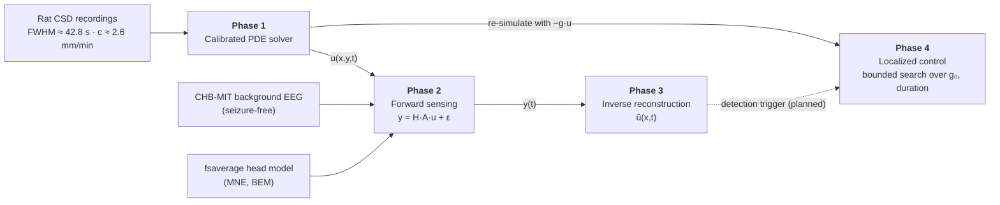

# Sense & Stop

**Inverse Reconstruction and Exploratory Control of Migraine-Related Cortical Waves Using Partial Differential Equations**

Cairo University – Faculty of Engineering · Systems & Biomedical Engineering Department (SBME)

> **Scope note.** This is a *computational study*, not a clinical tool. The model is a reduced reaction–diffusion model (no ionic, glial, vascular or neurovascular physiology). The CHB-MIT EEG is epilepsy-monitoring data and is used **only as realistic background noise** – it is never treated as a CSD recording. Rat recordings inform the model scale; they are not human migraine data. The control module is a hypothetical, exploratory extension.

---

## Table of contents

1. [Overview](#1-overview)
2. [Pipeline at a glance](#2-pipeline-at-a-glance)
3. [Phase details](#3-phase-details)
4. [Data contracts](#4-data-contracts)
5. [Repository structure](#5-repository-structure)
6. [Getting started](#6-getting-started)
7. [Configuration](#7-configuration)
8. [Outputs](#8-outputs)
9. [Current status & known gaps](#9-current-status--known-gaps)
10. [Team & responsibilities](#10-team--responsibilities)
11. [Data sources & references](#11-data-sources--references)

---

## 1. Overview

Cortical spreading depolarization (CSD) is a slow (~2–6 mm/min) wave of near-complete depolarization that travels across the cortex and is linked to migraine aura. We ask three questions in one pipeline:

| Question | Phase |
|---|---|
| How do we simulate a CSD-like wave at a physiologically sensible scale? | **1 – PDE model & calibration** |
| What would scalp sensors see, and can we recover the hidden wave from them? | **2 – Forward sensing**, **3 – Inverse reconstruction** |
| Could a localized intervention stop the wave? | **4 – Control (hypothetical)** |

The hidden object is the wave field **u(x, y, t)**. The observation model is

```
y(t) = H_bip · A · u(t) + ε(t)
```

- `u(t)` – wave state on the PDE grid (flattened), dimensionless (0 = rest, 1 = depolarized)
- `A` – sparse area-averaging matrix: PDE grid → cortical source vertices
- `H_bip` – bipolar BEM lead-field matrix: sources → scalp channels (V per A·m)
- `ε(t)` – real background EEG (CHB-MIT, decimated to the PDE sampling rate)

---

## 2. Pipeline at a glance



| Phase | Goal | Main code | Key output |
|---|---|---|---|
| 1 | Simulate and calibrate the wave | `src/model/solver.py`, `calibration.py` | `u[t, y, x]` |
| 2 | Map wave → scalp EEG with real noise | `build_A.py`, `build_Hbip.py`, `make_noise.py`, `sensors.py` | `A_matrix.npz`, `H_bip.npz`, `noise_2s.npz`, `y(t)` |
| 3 | Reconstruct the hidden wave from `y(t)` | `run_member5.py` | `û`, metrics JSON, 5 figures |
| 4 | Find a localized control that suppresses the wave | `src/control/control_strategy.py` | best control, efficacy metrics |
| – | End-to-end entry point | `run_pipeline.py` | baseline vs controlled run + metrics |

---

## 3. Phase details

### Phase 1 – PDE model & empirical calibration

**Files:** `src/model/solver.py`, `src/model/calibration.py`

Two reduced models are available (`model.type` in the config):

```
excitable (primary):  u_t = D ∇²u + k ( u(1−u)(u−a) − v ) − g(x,y,t)·u
                      v_t = k·ε·( u − γ·v )

fisher_kpp (baseline): u_t = D ∇²u + r·u(1−u) − g(x,y,t)·u
```

- `u` – normalized depolarization state; `v` – slow recovery variable; `a` – excitation threshold.
- `g·u` is the optional control hook (Phase 4). With `control=None` the primary code path is untouched.
- **Numerics:** 2nd-order central finite differences, no-flux (Neumann) boundaries via reflected ghost nodes; integrators `euler`, `rk4`, or `solve_ivp`. The internal `dt` is automatically reduced to satisfy the diffusion stability limit (0.5 for Euler, 0.69 for RK4, times a safety factor).
- 1D (`u[t, x]`) and 2D (`u[t, y, x]`) are both supported.

**Calibration to rat CSD data.** The excitable model has a simple scaling law: time scales with `1/k` and length with `√(D/k)`, so

```
FWHM = T₀ / k          c = c₀ · √(D·k)
⇒  k = T₀ / FWHM,      D = (c / c₀)² / k
```

where `(T₀, c₀)` are the dimensionless FWHM and speed measured once from a reference run with `D = k = 1`. Targets taken from the experimental recordings:

| Observable | Target |
|---|---|
| Temporal FWHM at one electrode | ≈ 42.8 s |
| Propagation speed | ≈ 2.6 mm/min |
| Implied spatial pulse width (`c × FWHM`) | ≈ 1.85 mm |

```python
import sys; sys.path.append("src")
from model import simulate, load_config, calibrate_excitable, pulse_metrics

cfg = load_config("configs/config.yaml")
cal_cfg, info = calibrate_excitable(cfg, fwhm_s=42.8, speed_mm_per_min=2.6)
res = simulate(cal_cfg)              # dict: u, v, t, x, y, units, params, meta
print(info["D_mm2_per_s"], info["k_per_s"], info["suggested_max_dx_mm"])
```

Other helpers: `measure_front_speed`, `pulse_speed`, `with_resolution` (fine "truth" grid vs coarse "inversion" grid), `save_result` / `load_result` (`.npz` + JSON metadata).

---

### Phase 2 – Forward sensing operator & real noise

**Files:** `build_A.py` → `build_Hbip.py` → `make_noise.py` → `sensors.py` (run in this order)

| Step | Script | What it does | Saves |
|---|---|---|---|
| 1 | `build_A.py` | Takes the `lateraloccipital-lh` label of `fsaverage` (ico-5 source space), keeps a 25 mm geodesic disc, **flattens it to 2D** (classical MDS on geodesic distances), fixes axis signs (x ≈ anterior, y ≈ superior), keeps sources inside a **30 × 20 mm** patch, and builds `A` by assigning every PDE node (0.1 mm grid, 301 × 201) to its nearest source (Voronoi cells, rows sum to 1). Includes sanity checks (row sums, constant and linear tests, unit normals). | `flat_patch.npz`, `A_matrix.npz` |
| 2 | `build_Hbip.py` | Reads units from the EDF header, checks the duplicate `T8-P8` and sign-flipped `P7-T7` channels (both dropped), runs an MNE BEM forward solution for the needed electrodes (`standard_1020` montage, fixed normal orientation), and builds `H_bip = M · H_el` with the derivation matrix `M` (reference-free bipolar montage). Prints singular values / effective rank. | `H_bip.npz` |
| 3 | `make_noise.py` | Loads three **seizure-free** CHB-MIT files (`chb01_01`, `chb01_02`, `chb01_08`; seizure status checked in the summary), removes the duplicate/flipped channels, anti-alias decimates **256 Hz → 0.5 Hz** (three zero-phase stages of ×8), trims 60 s of filter edges, and reports raw vs decimated noise std per channel. | `noise_2s.npz` |
| 4 | `sensors.py` | `make_sensors(u, H_bip, A, scale_am, noise_V, rng)` returns noisy and clean sensor data `[t, ch]` in volts. A random contiguous noise segment from a random file is added. Running the script as `__main__` is an **SNR sanity check** on a synthetic travelling Gaussian pulse at three dipole scales: 1, 10, 100 nA·m per source at `u = 1`. | – |

---

### Phase 3 – Regularized inverse reconstruction

**File:** `run_member5.py` (Member 5, "v2")

Recovers the hidden `u(x, t)` from noisy bipolar channels. Pre-processing is shared by both methods:

- first **60 s removed** (`T_CUT`), reconstruction scored for `x ≤ 25 mm` (`X_MAX`) to avoid the boundary;
- optional dropping of the noisiest channels (`DROP = ("P8-O2", "P4-O2")`; set `()` to keep all);
- data whitened with the Cholesky factor of the **measured noise covariance** (`noise_cov.npz`);
- the synthetic wave is uniform in `y`, so the gain is collapsed to 1D: `G(x) = Σ_y (Aᵀ Hᵀ)`;
- solver grid is **coarse (0.3 mm)**, interpolated to the 0.1 mm truth grid.

| | Method A – Tikhonov | Method B – travelling pulse |
|---|---|---|
| Idea | Free-form `û(x,t)` | Parametric Gaussian pulse `û = a·exp(−(x − x₀ − c·t)² / 2σ²)` |
| Unknowns | every coarse-grid value for `t ≥ 60 s` | `x₀`, `c`, `σ` (nonlinear) + amplitude `a` (linear) |
| Objective | `Σₜ‖L⁻¹(yₜ − G ûₜ)‖² + λ(‖Dₓû‖² + ‖Dₜû‖²) + ρ‖û‖²` (`ρ = 1e-4`) | whitened least squares, multi-start `least_squares` with bounds |
| Regularization | spatial + temporal difference penalties; `λ` swept over `geomspace(0.1, 1e4, 11)`, largest `λ` with whitened rms ≤ 1 is kept (discrepancy principle) | bounds on `x₀ ∈ [−10, 10]` mm, `c ∈ [0.02, 0.20]` mm/s, `σ ∈ [0.4, 4]` mm |
| Solver | `lsmr` | `scipy.optimize.least_squares` |
| Extra | – | optional **per-channel linear drift** nuisance term |

Experiments performed for each dipole scale (1, 10, 100 nA·m):

- **Scores:** relative L2 error, and mean front-position error for an *early* (60–300 s) and a *late* (300–541 s) window.
- **Drift stress test (Method B):** total drift of 0, 0.5, 2, 5 µV over 540 s with random sign per channel, with and without the drift nuisance term.
- **Detection rule (design):** a wave is declared when local `û > 0.3`.

---

### Phase 4 – Localized wave-suppression control (hypothetical)

**File:** `src/control/control_strategy.py`

A control term `−g(x,y,t)·u` is added to the PDE. `g` is a spatiotemporal Gaussian pulse:

```
g(x,y,t) = g₀ · exp(−((x−x₀)² + (y−y₀)²) / 2σ_r²) · exp(−(t−t_mid)² / 2σ_t²)     for t₀ ≤ t ≤ t₀+Δt
```

with `σ_r = 2 mm` by default, `t_mid = t₀ + Δt/2`, `σ_t = Δt/4`, and `g = 0` outside the window.

`bounded_control_search(...)` runs the baseline once, then simulates a **grid over `g₀` and duration `Δt`** (defaults used in `run_pipeline.py`: `g₀ ∈ [0.5, 2.5]`, `Δt ∈ [15, 35] s`, 3 × 3 = 9 runs) and scores each with `evaluate_control_efficacy`:

| Metric | Definition |
|---|---|
| `amplitude_reduction_pct` | `1 − peak_ctrl / peak_base` |
| `suppression_ratio_pct` | `1 − (#cells with u > 0.3 in controlled run) / (same, baseline)` – counted over the whole space-time array |
| `stopped_successfully` | `suppression_ratio > 70 %` |

The intended formulation (report, Eq. 7) is to reach ≥ 70 % reduction of depolarized tissue while minimizing the applied energy `∬∫ g² dx dy dt` – see [known gaps](#9-current-status--known-gaps).

---

## 4. Data contracts

| Object | Shape | Units / notes |
|---|---|---|
| `u` (default 2D wave, `u_2d_default.npy`) | `[271, 201, 301]` = `[t, y, x]` | dimensionless; `Δt = 2 s` (0–540 s), `Δx = Δy = 0.1 mm` (30 × 20 mm patch) |
| `simulate()["u"]` | `[t, x]` (1D) or `[t, y, x]` (2D) | `t` in s, `x`, `y` in mm |
| `A` | sparse `[N_src, 60 501]` | rows sum to 1; node index = `iy·301 + ix` |
| `H_bip` | `[N_ch, N_src]` | V per A·m; bipolar, fixed normal orientation |
| `noise_V` | `[3 files, N_ch, T]` | V, sampled at 0.5 Hz |
| `y` (sensors) | `[271, N_ch]` | V (reconstruction works in µV) |
| Dipole scale | 1e-9, 1e-8, 1e-7 | A·m per source at `u = 1` |

Channel order is the same in `H_bip.npz`, `noise_2s.npz` and `noise_cov.npz`. The EDF-derived montage gives 21 bipolar channels; the reconstruction step keeps 19 after dropping `P8-O2` and `P4-O2`.

---

## 5. Repository structure

```
sense-and-stop/
├── README.md
├── run_pipeline.py            # end-to-end entry point
├── configs/
│   └── config.yaml            # model, grid, solver, control settings
├── docs/                      # methodology, decisions, data cards
├── data/                      # manifests only – raw data stays outside Git
├── src/
│   ├── model/                 # Phase 1: solver.py, calibration.py, __init__.py
│   ├── forward/               # Phase 2: build_A.py, build_Hbip.py, make_noise.py, sensors.py
│   ├── inverse/               # Phase 3: run_member5.py
│   ├── control/               # Phase 4: control_strategy.py
│   └── data/                  # prepared arrays (.npz/.npy) – not versioned
└── outputs/                   # generated JSON + figures
```

`run_member5.py` imports `sensors.make_sensors` from the folder set in its `DATA` constant, so that folder must contain `sensors.py` (or point `sys.path` at `src/forward`).

---

## 6. Getting started

### Requirements

- Python ≥ 3.9
- `numpy`, `scipy`, `pyyaml`, `matplotlib`, `mne`

```bash
pip install numpy scipy pyyaml matplotlib mne
```

### Data (not included)

| Resource | Used for | Notes |
|---|---|---|
| MNE `fsaverage` template (source space, BEM solution, trans) | head model / lead field | e.g. `mne.datasets.fetch_fsaverage(...)` |
| PhysioNet CHB-MIT `chb01_01.edf`, `chb01_02.edf`, `chb01_08.edf`, `chb01-summary.txt` | background noise | check the dataset terms before use; do not commit raw files |

### Run

The Phase 2 scripts contain **hard-coded Windows paths** (`SUBJECTS_DIR`, `SCRATCH`, `CHB`, `EDF`) and `run_member5.py` has a `DATA` path – edit these constants first.

```bash
# --- offline data preparation (once) ---
python src/forward/build_A.py       # -> flat_patch.npz, A_matrix.npz
python src/forward/build_Hbip.py    # -> H_bip.npz
python src/forward/make_noise.py    # -> noise_2s.npz
python src/forward/sensors.py       # SNR sanity check at 3 dipole scales

# --- Phase 3: reconstruction study + figures ---
python src/inverse/run_member5.py

# --- Phases 1 & 4 via the master runner (run from the repo root) ---
python run_pipeline.py
```

`run_pipeline.py` prints a results block like:

```
 -> Baseline Peak Amplitude  : <value>
 -> Controlled Peak Amplitude: <value>
 -> Amplitude Reduction      : <value>%
 -> Wave Suppression Area    : <value>%
 -> Wave Stopped Status      : SUCCESS | FAILED
```

---

## 7. Configuration

`configs/config.yaml` (keys read by the code):

```yaml
model:
  type: excitable            # excitable | fisher_kpp
  dimension: 2               # 1 | 2
  excitable: {D: .., k: .., a: .., eps: .., gamma: ..}
  fisher_kpp: {D: .., r: ..}
domain:
  Lx: ..  Ly: ..  dx: ..  dy: ..
  boundary: neumann          # only no-flux is implemented
time:
  T: ..  output_dt: ..  dt: ..
initial_condition:
  type: edge_step            # edge_step | gaussian | kpp_exact_wave
  x0: ..  width: ..  amplitude: ..  center: [.., ..]   # center for gaussian
solver:
  method: rk4                # euler | rk4 | solve_ivp
  safety: 0.9                # + ivp_method / ivp_rtol / ivp_atol for solve_ivp
control_extension:
  target_location: [15.0, 10.0]   # x0, y0 in mm
  trigger_delay_s: 20.0           # start time t0 of the control window
```

---

## 8. Outputs

| File | Produced by | Content |
|---|---|---|
| `outputs/member5_v2_results.json` | `run_member5.py` | dropped channels, `dx_inv`, `t_cut`, per-scale metrics for Methods A and B (incl. drift test) |
| `outputs/fig1_spacetime_maps.png` | `run_member5.py` | truth vs Method A vs Method B space-time maps |
| `outputs/fig2_front_tracking.png` | `run_member5.py` | front position (argmax) vs time |
| `outputs/fig3_snapshots.png` | `run_member5.py` | spatial profiles at t = 120, 300, 480 s |
| `outputs/fig4_drift_test.png` | `run_member5.py` | recovered speed and front error vs drift |
| `outputs/fig5_sensors.png` | `run_member5.py` | clean vs noisy sensors, signal vs noise per channel |
| `*.npz` (`A_matrix`, `H_bip`, `noise_2s`, `flat_patch`) | Phase 2 scripts | prepared arrays, kept outside Git |

---

## 9. Current status & known gaps

Phases 1–4 are implemented as modules; the items below are what still separates the code from a fully closed-loop pipeline.

| # | Gap | Where | Suggested fix |
|---|---|---|---|
| 1 | Steps 2–3 of the runner only print messages – forward sensing and reconstruction are **not executed** by `run_pipeline.py` (they run offline via the scripts above). | `run_pipeline.py` | Call `make_sensors` and the reconstruction from the runner, or document them as offline stages. |
| 2 | The detection trigger (`û > 0.3`) is not connected; control starts at a fixed `trigger_delay_s` (default 20 s). In the calibrated run shown in the report the pulse passes x ≈ 15 mm at roughly t ≈ 300 s, so a 20–55 s control window would end before the wave arrives, and `−g·u` has no effect where `u ≈ 0` (suppression ≈ 0 %). | `run_pipeline.py`, config | Derive the start time from the wave arrival time or from the Phase 3 detection. |
| 3 | Candidate selection keeps the run with the **highest suppression**; the energy objective (Eq. 7) and the ≥ 70 % constraint are not used for ranking (70 % only sets the SUCCESS flag). | `bounded_control_search` | Among candidates with suppression ≥ 70 %, pick the one minimizing `∬∫ g²`. |
| 4 | `GaussianControl.__call__(X, Y, t)` does not match the 1D hook `control(x, t)` in the solver – control currently works in **2D only**. | `control_strategy.py`, `solver.py` | Make `Y` optional *after* `t`, or add a 1D wrapper. |
| 5 | `noise_cov.npz` and `u_2d_default.npy` are required by `run_member5.py`, but no script producing them is in the repo. | `run_member5.py` | Add the generating scripts or document how they are made. |
| 6 | Hard-coded Windows paths in the Phase 2 scripts and `run_member5.py`. | multiple | Move paths to the config file or CLI arguments. |
| 7 | Report vs. code notation: the report writes `v_t = b·u − v` and `R(û) = ‖û‖² + ‖∇û‖²`; the code uses `v_t = k·ε·(u − γ·v)` and spatial + temporal difference penalties plus a small ridge. | docs | Align the report with the code. |

---

## 10. Team & responsibilities

**Team members:** Jana Mostafa Mohamed Abd El-Aal · Jana Waleed Abdelhameed Seif · Jana Hazem Mohamed Taha · Habiba Ahmed Farhat Mohamed · Suty Fady Zakaria Makar · Ganna Emad El-Din Salah Ali

| Member | Responsibility |
|---|---|
| 1 | Project & data lead – repo scaffold, data inventory, provenance manifest, decision log |
| 2 | Experimental CSD data steward – import, artifact flagging, empirical ranges, data card |
| 3 | PDE & numerical model lead – solver, config, calibration, model interface |
| 4 | Forward sensing & EEG lead – channel map, head model, `H`, noise preparation |
| 5 | Inverse problem lead – regularized reconstruction, output/metadata contract |
| 6 | Integration, documentation & control extension – run script, setup guide, control search |

---

## 11. Data sources & references

- **Experimental CSD recordings (rat):** DC potential + Doppler blood-flow traces (animals R4, R5, R6) used to set the FWHM (≈ 42.8 s) and speed (≈ 2.6 mm/min) – model scale only.
- **PhysioNet CHB-MIT Scalp EEG Database:** seizure-free segments, background/noise only.
- **MNE-Python `fsaverage`:** template anatomy and BEM; a modeling scaffold, not participant-specific.
- **Literature context:** *Spreading Depolarization and Migraine: From Aura to Pain* (project review).

Please record dataset versions, licenses and retrieval dates in the data manifest before publishing, and cite the sources above in any derived work.
