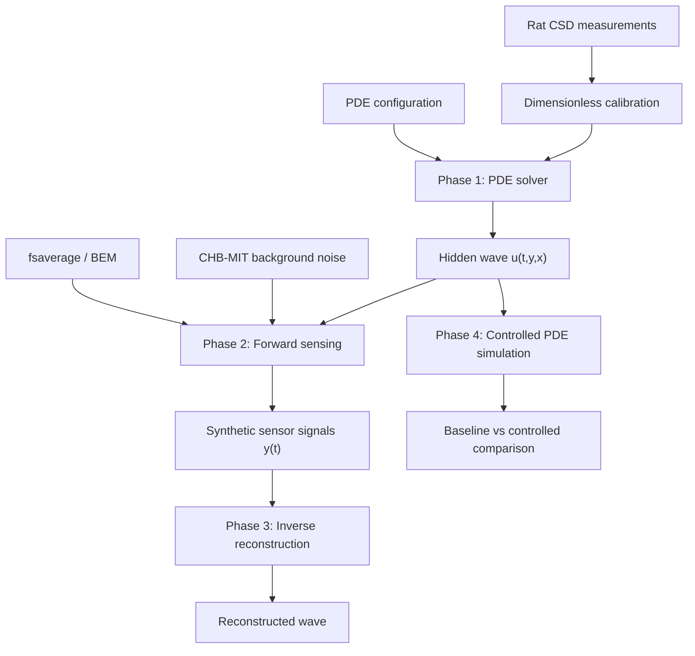

# Sense & Stop

## Inverse Reconstruction and Exploratory Control of Migraine-Related Cortical Waves Using Partial Differential Equations

**Cairo University · Faculty of Engineering · Systems & Biomedical Engineering Department (SBME)**

> **Scientific scope:** Sense & Stop is a computational research project, not a clinical tool. Its primary PDE is a reduced phenomenological reaction–diffusion model. It does not explicitly model ionic dynamics, glial buffering, membrane pumps, metabolism, perfusion, or neurovascular coupling. Rat cortical spreading depolarization (CSD) recordings inform model timing; they are not human migraine data. CHB-MIT EEG is used exclusively as realistic background noise, not as a CSD recording. The localized-control module is hypothetical and exploratory.

---

## Contents

1. Project overview
2. Pipeline and implementation status
3. Phase 1 — PDE model and calibration
4. Phase 2 — Forward sensing and background EEG
5. Phase 3 — Inverse reconstruction
6. Phase 4 — Exploratory localized control
7. Data contracts and units
8. Repository structure
9. Installation and running
10. Configuration reference
11. Outputs and reproducibility
12. Current status and known gaps
13. Team responsibilities
14. Data sources and references

---

## 1. Project overview

Cortical spreading depolarization is a slowly propagating wave of near-complete neuronal and glial depolarization associated with migraine aura.

This project explores three main questions:

| Research question | Phase |
|---|---|
| Can we simulate a CSD-inspired travelling pulse at a scale informed by experimental recordings? | Phase 1 — PDE model and calibration |
| What synthetic scalp measurements would result from the hidden wave, and can the wave be reconstructed from them? | Phases 2 and 3 — Forward sensing and inverse reconstruction |
| How does a hypothetical localized intervention affect the simulated wave? | Phase 4 — Exploratory control |

The hidden field is the dimensionless state \(u(x,y,t)\).

The intended observation model is:

\[
y(t)=H_{\mathrm{bip}}Au(t)+\varepsilon(t)
\]

Where:

- \(u(t)\): PDE state on the simulation grid, flattened using the agreed grid ordering.
- \(A\): sparse area-averaging operator mapping PDE nodes to cortical source locations.
- \(H_{\mathrm{bip}}\): bipolar BEM lead-field matrix mapping source dipole moments to scalp channels.
- \(\varepsilon(t)\): real background EEG noise, decimated to the PDE output sampling interval.
- \(y(t)\): synthetic sensor measurements.

The source-amplitude multiplier used in forward experiments is illustrative and has not been physiologically calibrated.

---

## 2. Pipeline and implementation status

The project has four computational phases. They exist as separate modules and scripts, but the repository does not yet provide a fully integrated, closed-loop execution of all four phases.

| Phase | Purpose | Main implementation | Status |
|---|---|---|---|
| 1 | PDE simulation and calibration | `src/model/solver.py`, `src/model/calibration.py` | Implemented; model tests pass |
| 2 | Forward sensing and background EEG | `src/forward/` | Scripts implemented; require external data and local path configuration |
| 3 | Inverse reconstruction | `src/inverse/run_member5.py` | Standalone reconstruction study; requires prepared arrays |
| 4 | Localized control | `src/control/control_strategy.py` | Control functions implemented; optimization and integration incomplete |
| — | Master runner | `run_pipeline.py` | Integration incomplete |

### Intended research flow



**Current implementation warning:** The current `run_pipeline.py` does not execute forward sensing or inverse reconstruction. Those sections only print messages. It also passes `configs/config.yaml` directly to `simulate()`, although that master configuration does not contain the complete PDE sections required by the solver.

The master configuration must first be combined with `configs/model_default.yaml`. Therefore, `python run_pipeline.py` should not be described as a functioning end-to-end pipeline until this issue is fixed and tested.

---

## 3. Phase 1 — PDE model and calibration

**Main files**

- `src/model/solver.py`
- `src/model/calibration.py`
- `src/model/__init__.py`
- `configs/model_default.yaml`
- `tests/test_model.py`
- `docs/model_specification.md`
- `docs/interface_note_model.md`

### 3.1 Available models

Two reduced reaction–diffusion models are implemented.

**Primary model: Excitable (FitzHugh–Nagumo type)**

\[
u_t=D\nabla^2u+k[u(1-u)(u-a)-v]-g(x,y,t)u
\]

\[
v_t=k\epsilon(u-\gamma v)
\]

Where:

- \(u\): dimensionless excitation/depolarization state.
- \(v\): dimensionless recovery variable.
- \(D\): diffusion coefficient.
- \(k\): reaction time-scale parameter.
- \(a\): excitation threshold and pulse-shape parameter.
- \(\epsilon,\gamma\): recovery parameters.
- \(g(x,y,t)\): optional localized control term.

The excitable model produces a travelling pulse followed by recovery. It is the primary model because it includes a recovery variable.

**Baseline model: Fisher–KPP**

\[
u_t=D\nabla^2u+ru(1-u)-g(x,y,t)u
\]

Fisher–KPP is retained as a simpler travelling-front baseline. It has no recovery variable or refractory tail.

Its theoretical minimum wave speed for sufficiently steep initial conditions is:

\[
c^*=2\sqrt{Dr}
\]

### 3.2 Calibration basis

The calibration uses two different sources of information:

| Observable | Baseline target | Provenance |
|---|---:|---|
| Temporal pulse FWHM | Approximately 42.8 s | Preliminary rat S1 recordings |
| Propagation speed | 2.6 mm/min | Literature-derived midpoint of a cited 2.3–2.9 mm/min range |
| Implied spatial pulse width | Approximately 1.85 mm | Derived from speed × temporal FWHM |

The rat measurements are preliminary. The propagation speed is not measured from the single-electrode rat recordings and the cited literature ranges still require independent verification by the team.

These are not human migraine measurements.

### 3.3 Excitable-model scaling

For fixed shape parameters \(a,\epsilon,\gamma\), a dimensionless reference simulation with \(D=k=1\) provides:

- \(T_0\): dimensionless pulse FWHM.
- \(c_0\): dimensionless propagation speed.

The scaling relationships are:

\[
F=\frac{T_0}{k}
\]

\[
c=c_0\sqrt{Dk}
\]

For a target FWHM \(F\) and speed \(c\):

\[
k=\frac{T_0}{F}
\]

\[
D=\frac{(c/c_0)^2}{k}
\]

The implementation is `calibrate_excitable()` in `src/model/calibration.py`.

It returns a copied configuration and an information dictionary containing the calibrated parameters, length scale, implied pulse width, and suggested maximum grid spacing.

Do not manually edit calibrated \(D\) and \(k\) when changing calibration targets. Rerun the calibration.

Example:

```python
from src.model import (
    load_config,
    calibrate_excitable,
    simulate,
    pulse_metrics
)

cfg = load_config("configs/model_default.yaml")

calibrated_cfg, info = calibrate_excitable(
    cfg,
    fwhm_s=42.8,
    speed_mm_per_min=2.6
)

result = simulate(calibrated_cfg)

metrics = pulse_metrics(result, x_probe=15.0)

print(info["D_mm2_per_s"])
print(info["k_per_s"])
print(metrics)
```

### 3.4 Default model parameters

The reference parameters are stored in `configs/model_default.yaml`.

| Parameter | Value | Unit | Provenance |
|---|---:|---|---|
| Model type | excitable | — | Primary design choice |
| Reference dimension | 1D | — | Member 3 reference configuration |
| D | 0.018561 | mm²/s | Calibrated |
| k | 0.503758 | s⁻¹ | Calibrated |
| a | 0.1 | — | Design choice |
| ε | 0.01 | — | Design choice |
| γ | 2.0 | — | Design choice |
| Fisher–KPP D | 0.01296 | mm²/s | Baseline parameter |
| Fisher–KPP r | 0.036 | s⁻¹ | Baseline parameter |
| Lx | 30 | mm | Domain design choice |
| Ly | 20 | mm | 2D domain |
| dx, dy | 0.1 | mm | Frozen forward-grid spacing |
| Simulation duration | 540 | s | Design choice |
| Output interval | 2 | s | Frozen forward time grid |
| Target internal dt | 0.1 | s | Solver target |
| Boundary | Neumann | — | No-flux boundary |
| Integrator | RK4 | — | Default |
| Safety factor | 0.9 | — | Stability guard |

The shape parameters are sensitive. Previous scans recorded that larger values of \(a\) or \(\epsilon\) can prevent a sustained pulse. Rerun the model tests after changing them.

### 3.5 Numerical method

The solver supports:

- Second-order central finite differences in space.
- No-flux (Neumann) boundaries using reflected ghost nodes.
- Explicit Euler integration.
- RK4 integration.
- `scipy.integrate.solve_ivp` as an adaptive reference integrator.
- 1D and 2D simulation grids.

The solver automatically chooses an internal time step that divides the output interval into an integer number of substeps.

For Euler and RK4, it applies a diffusion stability guard based on:

\[
\Lambda=D\,dt\left(\frac{1}{dx^2}+\frac{1}{dy^2}\right)
\]

The y term is omitted in 1D.

The configured stability limits are 0.5 for Euler and 0.69 for RK4, multiplied by the safety factor.

The realized internal time step and stability number are available in:

```python
result["meta"]["dt_internal_s"]
result["meta"]["stability_number"]
```

### 3.6 Initial conditions

The default initial condition is an edge step:

\[
u(x,0)=\frac{1}{2}
\left[
1-\tanh\left(\frac{x-x_0}{w}\right)
\right]
\]

With:

- \(x_0=3\) mm
- \(w=0.5\) mm

The recovery variable starts at zero.

In 2D, the same x-profile is repeated along y, creating a full-width initial strip.

Other supported initial-condition types:

- `gaussian`
- `kpp_exact_wave` — Fisher–KPP solver verification only.

### 3.7 Model output and public API

The solver API includes:

```python
simulate(config, control=None)
load_config(path)
with_resolution(config, dx=None, dy=None, dt=None, method=None)
measure_front_speed(result, level=0.5, t_window=None)
save_result(result, path)
load_result(path)
```

The returned dictionary contains:

- `u`
- `v`
- `t`
- `x`
- `y`
- `units`
- `params`
- `meta`

Array ordering:

- 1D: `[time, x]`
- 2D: `[time, y, x]`

**Important:** Do not clip the excitable state to [0, 1]. The recovery tail includes a negative undershoot, approximately −0.2 to −0.3 in the documented run. Clipping changes the model being tested.

Fisher–KPP, in contrast, is tested to remain within the unit interval.

### 3.8 Reference configuration versus forward configuration

This distinction is essential:

**`configs/model_default.yaml`**

- Contains the PDE physics and numerical settings.
- Defaults to 1D.
- Used for Member 3 reference tests.

**`configs/config.yaml`**

- Acts as the master/integration configuration.
- Sets `model.dimension: 2` for the forward-sensing grid.
- Contains paths and forward/inverse settings.
- Does not duplicate the PDE domain, time, solver, or initial-condition sections.

`src/forward/sensors.py` contains `model_cfg()`, which loads the reference model configuration and applies the dimension override from the master configuration.

Do not change the reference configuration to 2D merely because the forward model needs 2D output.

The default 2D edge-step solution is invariant along y. It is therefore a planar wave represented on a 2D grid, not a demonstration of arbitrary two-dimensional wave dynamics.

---

## 4. Phase 2 — Forward sensing and background EEG

**Main files**

- `src/forward/build_A.py`
- `src/forward/build_Hbip.py`
- `src/forward/make_noise.py`
- `src/forward/sensors.py`
- `docs/interface_note_forward.md`

The intended forward model is:

\[
y(t)=sH_{\mathrm{bip}}Au(t)+\eta\varepsilon(t)
\]

Where \(s\) is an illustrative source dipole-moment scale and \(\eta\) is the noise multiplier.

### 4.1 PDE-to-source averaging matrix A

`build_A.py`:

1. Loads the MNE `fsaverage` template and the left lateral-occipital label.
2. Uses an ico-5 source space and a 25 mm geodesic disc.
3. Flattens the cortical patch into 2D using classical multidimensional scaling of geodesic distances.
4. Fixes the flat coordinate signs using anatomical coordinate correlations.
5. Keeps sources inside a 30 × 20 mm rectangular patch.
6. Assigns every PDE grid node to its nearest source.
7. Builds a sparse area-averaging matrix A.

The documented interface contains:

- 73 retained sources.
- 60,501 PDE nodes (301 × 201).
- A expected shape of `[73, 60501]`.

The rows are normalized averaging weights.

The script currently has hard-coded local paths (`SUBJECTS_DIR` and `OUT_DIR`). It is marked provisional and must be configured for the machine on which it is run.

### 4.2 Bipolar lead field

`build_Hbip.py`:

1. Reads the EDF header and checks physical units.
2. Checks the duplicate T8-P8 channel pair and sign-reversed P7-T7 channel.
3. Builds an MNE EEG BEM forward solution using the `fsaverage` template and `standard_1020` montage.
4. Uses fixed normal orientation.
5. Constructs a bipolar derivation matrix M:

\[
H_{\mathrm{bip}}=MH_{\mathrm{el}}
\]

The documented matrix shape is `[21 channels, 73 sources]`.

Units are volts per ampere-metre (V per A·m).

The script drops:

- `P7-T7`: sign-reversed copy of `T7-P7`.
- `T8-P8-1`: duplicate channel.

It currently uses hard-coded local paths (`SUBJECTS_DIR`, `SCRATCH`, and `EDF`).

### 4.3 Background EEG preparation

`make_noise.py` uses three CHB-MIT files:

- `chb01_01.edf`
- `chb01_02.edf`
- `chb01_08.edf`

The script checks their seizure annotations in the CHB-MIT summary file.

It removes the duplicate and sign-reversed channels, then anti-alias decimates:

\[
256\text{ Hz}\rightarrow0.5\text{ Hz}
\]

using three zero-phase stages of ×8.

It trims 60 seconds from each end to reduce filter-edge effects.

The expected output is `noise_2s.npz`, with noise array layout:

`[file, channel, time]`

The script currently uses hard-coded `CHB` and `SCRATCH` paths.

**Interpretation warning:** Decimation to 0.5 Hz removes much of the original EEG frequency content. The resulting signal is a low-rate background-noise component for this simulation, not a full-band EEG analysis.

### 4.4 Synthetic sensor generation

`sensors.py` provides:

```python
make_sensors(
    u,
    H_bip,
    A,
    scale_am,
    noise_V,
    rng,
    noise_gain=1.0
)
```

It returns:

```python
noisy_sensors, clean_sensors
```

Both arrays have shape `[time, channel]` and are expressed in volts.

The function selects one file and one contiguous time segment from the prepared noise array.

When executed as a script, `sensors.py` performs an SNR sanity check using a synthetic travelling Gaussian pulse at three illustrative source scales:

- 1 nA·m
- 10 nA·m
- 100 nA·m

These scales are not physiologically calibrated.

The helper `model_cfg()` loads `configs/model_default.yaml` and applies the 2D dimension from `configs/config.yaml`.

---

## 5. Phase 3 — Inverse reconstruction

**Main file:** `src/inverse/run_member5.py`

**Interface documentation:** `docs/interface_note_forward.md`

The inverse study estimates a hidden 1D wave profile \(\hat u(x,t)\) from noisy bipolar measurements.

Because the default synthetic wave is uniform along y, the inverse script uses the x-profile and collapses the forward gain across y.

### 5.1 Shared preprocessing

Current script settings:

| Setting | Value |
|---|---|
| Initial time removed | 60 s |
| Scoring region | x ≤ 25 mm |
| Inverse grid spacing | 0.3 mm |
| Truth grid spacing | 0.1 mm |
| Dropped channels | `P8-O2`, `P4-O2` |
| Dipole scales | 1e-9, 1e-8, 1e-7 A·m |
| Ridge parameter | 1e-4 |
| Random seed | 123 |

The first 60 seconds are excluded because the pulse amplitude is still settling.

The reconstruction is scored only up to x = 25 mm to reduce boundary effects.

The inverse grid is coarser than the truth grid to avoid using an identical discretization for data generation and inversion.

The data are whitened using the Cholesky factor of the measured noise covariance.

The script drops two high-noise channels by default, leaving 19 of the 21 bipolar channels.

### 5.2 Method A — Tikhonov reconstruction

Method A estimates a free-form field on the coarse grid.

Its objective combines:

- Whitened data misfit.
- Spatial first-difference regularization.
- Temporal first-difference regularization.
- A small ridge term.

It uses `scipy.sparse.linalg.lsmr`.

The regularization parameter λ is swept over 11 logarithmically spaced values from 0.1 to 10,000.

The script retains the largest tested λ for which the whitened residual RMS is at most 1, following the implemented discrepancy rule.

### 5.3 Method B — Travelling-pulse reconstruction

Method B fits a parametric Gaussian travelling pulse:

\[
\hat u(x,t)=a
\exp\left[
-\frac{(x-x_0-ct)^2}{2\sigma^2}
\right]
\]

The nonlinear parameters are:

- Initial position \(x_0\).
- Speed \(c\).
- Width \(\sigma\).

Amplitude \(a\) is solved linearly for each nonlinear candidate.

The implementation uses bounded, multi-start `scipy.optimize.least_squares`.

Current bounds:

- \(x_0\in[-10,10]\) mm
- \(c\in[0.02,0.20]\) mm/s
- \(\sigma\in[0.4,4]\) mm

An optional per-channel linear drift nuisance term is included in the Method B stress test.

### 5.4 Experiments and metrics

For each of the three source scales, the script reports:

- Relative L2 reconstruction error.
- Mean front-position error in an early window (60–300 s).
- Mean front-position error in a late window (300–541 s).
- Method B recovered speed, width, amplitude, and whitened residual RMS.
- Drift stress test with total per-channel drift of 0, 0.5, 2, and 5 µV over 540 seconds, with and without the drift nuisance term.

The threshold:

\[
\hat u>0.3
\]

is documented as a detection-rule design. It is **not connected to the control trigger** in the current pipeline.

### 5.5 Required prepared arrays

`run_member5.py` currently reads:

- `H_bip.npz`
- `A_matrix.npz`
- `noise_2s.npz`
- `noise_cov.npz`
- `u_2d_default.npy`

The script has a hard-coded Windows `DATA` path near the top. It must be edited to point to the folder containing these files.

The master configuration's `paths.data_dir` is not currently used by this script.

There is no confirmed in-repository generation script for `noise_cov.npz` or `u_2d_default.npy`. They must be supplied from the team's prepared data or generated using a separately documented procedure.

Do not assume the three forward preparation scripts generate every required inverse input.

---

## 6. Phase 4 — Exploratory localized control

**Main file:** `src/control/control_strategy.py`

The control extension adds a localized damping term:

\[
u_t=D\nabla^2u+\text{reaction terms}-g(x,y,t)u
\]

The implemented Gaussian control is:

\[
g(x,y,t)=g_0
\exp\left[
-\frac{(x-x_0)^2+(y-y_0)^2}{2\sigma_r^2}
\right]
\exp\left[
-\frac{(t-t_{\mathrm{mid}})^2}{2\sigma_t^2}
\right]
\]

It is active only during:

\[
t_0\leq t\leq t_0+\Delta t
\]

Otherwise, \(g=0\).

Current defaults:

- Spatial width: \(\sigma_r=2\) mm.
- Temporal midpoint: \(t_{\mathrm{mid}}=t_0+\Delta t/2\).
- Temporal width: \(\sigma_t=\Delta t/4\).

### 6.1 Implemented functions

- `GaussianControl`: evaluates the localized space-time Gaussian.
- `evaluate_control_efficacy`: compares baseline and controlled arrays.
- `bounded_control_search`: runs a baseline and a grid of candidate interventions.

### 6.2 Current efficacy metrics

| Metric | Implemented definition |
|---|---|
| Baseline peak | Maximum u in baseline array |
| Controlled peak | Maximum u in controlled array |
| Amplitude reduction | \(100(1-\text{peak}_{ctrl}/\text{peak}_{base})\) |
| Suppression ratio | \(100[1-N(u_{ctrl}>0.3)/N(u_{base}>0.3)]\) |
| Success flag | Suppression ratio strictly greater than 70% |

The suppression metric counts entries over the entire space-time array. It is not a spatial-area-only measurement at one selected time.

### 6.3 Current limitations

1. The current `GaussianControl.__call__` signature is `(X, Y, t)`. The solver calls a 1D control as `(x, t)` and a 2D control as `(X, Y, t)`. Therefore, the current class is compatible with the 2D call but does not match the solver's 1D call signature.
2. The bounded search selects the candidate with the largest suppression ratio. It does not yet minimize intervention energy subject to a ≥70% suppression constraint.
3. The runner uses a fixed trigger time, with a 20-second fallback. It does not use a detection event from inverse reconstruction.
4. The default control target is `[15, 10]` mm when no control settings are supplied.
5. `configs/config.yaml` currently does not define a `control_extension` section.
6. The control represents a hypothetical mathematical intervention, not a validated treatment.

---

## 7. Data contracts and units

| Object | Expected shape | Units / notes |
|---|---|---|
| 1D PDE state u | `[nt, nx]` | Dimensionless |
| 2D PDE state u | `[nt, ny, nx]` | Dimensionless |
| Default 2D wave | `[271, 201, 301]` | 0–540 s, 2 s interval, 0.1 mm spacing |
| A | Sparse `[73, 60501]` | PDE nodes to 73 sources |
| H_bip | `[21, 73]` | V per A·m |
| noise_V | `[3, 21, n_time]` | V |
| Noise covariance C | `[21, 21]` | V² |
| Synthetic sensor data | `[271, 21]` | V |
| Inverse channels | 19 | After dropping P8-O2 and P4-O2 |
| Source scales | 1e-9, 1e-8, 1e-7 | A·m per source at u = 1; illustrative |

### Coordinate and channel conventions

- PDE node indexing for A: `iy * nx + ix`.
- x varies fastest.
- Solver coordinate arrays include both domain boundaries.
- In 2D, `u[t, iy, ix]` follows time-y-x ordering.
- Bipolar channels are first electrode minus second electrode.
- Channel ordering must match across `H_bip.npz`, `noise_2s.npz`, and `noise_cov.npz`.
- Do not clip the excitable u field before forward mapping or inverse comparison.

### Default 2D wave interpretation

The documented `u_2d_default.npy` is stored on a 2D grid, but the default edge-step stimulus is identical along y.

The saved field is invariant along y and contains only x-and-time variation.

Therefore, the default run does not demonstrate reconstruction of arbitrary 2D wave structure.

---

## 8. Repository structure

```text
sense-and-stop/
├── README.md
├── run_pipeline.py
├── configs/
│   ├── config.yaml
│   └── model_default.yaml
├── docs/
│   ├── model_specification.md
│   ├── interface_note_model.md
│   └── interface_note_forward.md
├── results/
│   └── tables/
│       ├── table1_provenance.csv
│       └── table1b_model_values.csv
├── notebooks/
│   └── Member3_Colab.ipynb
├── src/
│   ├── model/
│   │   ├── solver.py
│   │   ├── calibration.py
│   │   └── __init__.py
│   ├── forward/
│   │   ├── build_A.py
│   │   ├── build_Hbip.py
│   │   ├── make_noise.py
│   │   └── sensors.py
│   ├── inverse/
│   │   └── run_member5.py
│   └── control/
│       └── control_strategy.py
└── tests/
    └── test_model.py
```

Raw datasets, prepared arrays, and large generated outputs should not be committed unless the team has explicitly agreed to version them and verified their licensing and size.

---

## 9. Installation and running

Run commands from the repository root.

### 9.1 Install requirements

The model and tests require NumPy, SciPy, PyYAML, and pytest. Forward preparation additionally uses MNE-Python; inverse plotting uses Matplotlib.

```powershell
python -m pip install numpy scipy pyyaml pytest matplotlib mne
```

### 9.2 Run the complete model test suite

```powershell
python -m pytest -v
```

Run only the excitable-model tests:

```powershell
python -m pytest -v tests/test_model.py -k "excitable"
```

The latest reported local verification for this repository snapshot was **21 passed** in the complete test suite.

These tests validate the PDE implementation and its model-level contracts. They do not validate the complete forward/inverse pipeline or clinical relevance.

### 9.3 Run the 1D reference model

```python
from src.model import (
    load_config,
    simulate,
    pulse_metrics,
    pulse_speed
)

cfg = load_config("configs/model_default.yaml")

result = simulate(cfg)

print("u shape:", result["u"].shape)
print("internal dt:", result["meta"]["dt_internal_s"])
print("FWHM:", pulse_metrics(result, 15.0))
print("speed (mm/s):", pulse_speed(result, 10.0, 20.0))
```

### 9.4 Prepare a 2D configuration for forward work

The forward helper loads the reference configuration and applies the master dimension override:

```python
from src.model import simulate
from src.forward.sensors import load_cfg, model_cfg

master_cfg = load_cfg("configs/config.yaml")

forward_cfg = model_cfg(master_cfg)

result_2d = simulate(forward_cfg)

print(result_2d["u"].shape)
```

The expected shape is `[time, y, x]`.

A full default 2D run requires substantially more memory and computation than the 1D reference test.

### 9.5 Prepare forward assets

The intended script order is:

```powershell
python src/forward/build_A.py
python src/forward/build_Hbip.py
python src/forward/make_noise.py
python src/forward/sensors.py
```

Before running:

1. Install and configure MNE-Python.
2. Download or locate the required fsaverage source-space, transform, and BEM files.
3. Obtain the CHB-MIT EDF files and summary file under the dataset's terms.
4. Edit the hard-coded `SUBJECTS_DIR`, `OUT_DIR`, `SCRATCH`, `EDF`, and `CHB` paths.
5. Ensure all scripts use consistent output folders and channel ordering.

The preparation scripts currently save to machine-specific scratch paths.

The master configuration defaults to `data/derived`, while `run_member5.py` uses a separate hard-coded data path. These locations must be reconciled before downstream execution.

### 9.6 Run inverse reconstruction

After preparing the required arrays, edit the `DATA` path near the top of `src/inverse/run_member5.py`.

The folder must contain:

- `H_bip.npz`
- `A_matrix.npz`
- `noise_2s.npz`
- `noise_cov.npz`
- `u_2d_default.npy`

Then run:

```powershell
python src/inverse/run_member5.py
```

Set `SHOW = False` in the script if figures should be saved without opening interactive windows.

The current forward preparation scripts do not create every required inverse input. In particular, no confirmed in-repository generation script exists for `noise_cov.npz` or `u_2d_default.npy`.

### 9.7 Master runner

`run_pipeline.py` is an integration scaffold, not a verified end-to-end command.

It currently:

- Passes the master configuration directly to the PDE solver without first merging `model_default.yaml`.
- Prints placeholder messages for forward sensing.
- Prints placeholder messages for inverse reconstruction.
- Runs a baseline simulation and a control parameter search.

See Section 12 before attempting to use it as a complete pipeline.

---

## 10. Configuration reference

### `configs/model_default.yaml`

Contains the Member 3 model physics and numerical setup:

- Model type and reference dimension.
- Excitable and Fisher–KPP parameters.
- Spatial domain and boundary condition.
- Simulation duration, output interval, and target internal step.
- Numerical integrator and stability safety factor.
- Initial-condition type and parameters.
- Unit labels and parameter provenance.

This is the single source of truth for PDE parameters.

### `configs/config.yaml`

The master/integration configuration currently contains:

- `paths.model_config`: path to `configs/model_default.yaml`.
- `paths.data_dir`: default prepared-data directory (`data/derived`).
- `paths.outputs_dir`: output directory.
- `model.dimension`: dimension override for forward work (currently 2).
- `forward.files`: expected filenames for H, A, patch, noise, covariance, and default wave arrays.
- `forward.scales_am`, `noise_gain`, and `seed`.
- `inverse` settings copied from the inverse script and marked for Member 5 confirmation.

It does not duplicate the PDE domain, time, solver, or initial-condition sections.

Code that needs a complete simulation configuration must load `model_default.yaml` and apply the master overrides. `src/forward/sensors.py:model_cfg()` already follows this pattern.

---

## 11. Outputs and reproducibility

### Model output

`simulate()` returns arrays and metadata in memory.

`save_result()` stores arrays in a compressed NPZ file and serializes units, parameters, and solver metadata as JSON within the archive.

`load_result()` reconstructs the result dictionary.

Metadata includes:

- Solver method.
- Realized internal time step.
- Grid spacing.
- Stability number.
- Whether control was active.
- Solver version.
- A copy of the configuration.

### Inverse-study output

`src/inverse/run_member5.py` writes:

| Output | Content |
|---|---|
| `outputs/member5_v2_results.json` | Reconstruction metrics by source scale and method, including drift-test results |
| `outputs/fig1_spacetime_maps.png` | Truth and reconstructed space-time maps |
| `outputs/fig2_front_tracking.png` | Front position versus time |
| `outputs/fig3_snapshots.png` | Spatial profiles at selected times |
| `outputs/fig4_drift_test.png` | Recovered speed and front error versus imposed drift |
| `outputs/fig5_sensors.png` | Clean/noisy sensor signals and channel noise comparison |

These files are generated only when the inverse script runs successfully with its required prepared arrays.

### Reproducibility rules

- Keep raw EEG and other licensed data outside Git unless project policy and licensing permit inclusion.
- Record dataset versions, download dates, file identifiers, and license terms.
- Distinguish measured rat values, literature-derived targets, calibrated parameters, design choices, and illustrative forward scales.
- Preserve the exact configuration used for each saved simulation.
- Record random seeds for noise selection and reconstruction experiments.
- Do not describe illustrative dipole scales as physiological measurements.
- Do not present passing software tests as proof of biological validity.

---

## 12. Current status, limitations, and known gaps

### 12.1 Verified model status

The following model-level checks were reported as passing locally:

- 21/21 tests passed in `tests/test_model.py`.
- Fisher–KPP exact travelling-wave verification.
- Spatial and temporal convergence.
- Independent RK4 versus `solve_ivp` agreement.
- Stability guard and Neumann boundary checks.
- 1D/2D planar-wave consistency.
- Excitable pulse timing, speed, recovery, and resolution convergence.
- Pulse measurement and calibration checks.
- Control-hook default-off and effectiveness check.
- Save/load round-trip check.

The latest reported repository state was synchronized with `origin/main`, with a clean working tree at commit `006aaf4`.

The README replacement itself still needs to be committed.

### 12.2 Scientific limitations

1. **Reduced physiology:** the PDE is phenomenological and omits ionic, glial, vascular, metabolic, and neurovascular mechanisms.
2. **Rat-only calibration basis:** S1 recordings are preliminary rat data and do not establish human migraine parameters.
3. **Provisional speed target:** 2.6 mm/min is literature-derived, not measured in the rat recordings. The cited papers and applicability of their ranges need verification.
4. **Pulse-decay mismatch:** the model's 10% decay time is approximately 28 s, shorter than the rat mean of approximately 40.7 s. This is intentionally documented in the tests and must not be presented as a match.
5. **Recovery undershoot:** the excitable state becomes negative behind the pulse. This is a model behaviour, not a measured physiological prediction.
6. **One-dimensional effective default wave:** the saved 2D wave is uniform along y and does not demonstrate recovery of arbitrary 2D structure.
7. **Illustrative source scaling:** dipole-moment scales have not been calibrated against a measured cortical source.
8. **Template anatomy:** fsaverage is a template, not an individual participant head model. The forward note describes it as an adult template, while CHB-MIT background data are pediatric; this mismatch limits interpretation.
9. **Noise bandwidth:** decimating 256 Hz EEG to 0.5 Hz removes most of the original EEG frequency content.
10. **Source spacing and flattening:** the documented 73-source patch has mean nearest-neighbour spacing around 2.45 mm, comparable to the approximately 1.85 mm model pulse width. Sub-source-spacing detail is not identifiable from this mapping.

### 12.3 Software and integration gaps

| # | Gap | Location | Required work |
|---|---|---|---|
| 1 | Master runner passes `config.yaml` directly to `simulate()`, although the master file lacks the complete PDE configuration. | `run_pipeline.py`, `configs/config.yaml` | Load `model_default.yaml`, apply master overrides, and test the runner. |
| 2 | Forward and inverse stages in the master runner only print messages. | `run_pipeline.py` | Integrate actual sensor and inverse calls, or clearly retain them as offline stages. |
| 3 | Inverse script uses a hard-coded Windows data path and does not read `paths.data_dir`. | `src/inverse/run_member5.py` | Move the data path to configuration, CLI, or environment settings. |
| 4 | Forward preparation scripts use hard-coded machine-specific paths. | `src/forward/` | Move paths into shared configuration or CLI arguments. |
| 5 | Required inverse inputs `noise_cov.npz` and `u_2d_default.npy` have no confirmed in-repository generation script. | `src/inverse/run_member5.py` | Add or document reproducible generation steps and validate metadata. |
| 6 | Control trigger is fixed rather than driven by inverse detection. | `run_pipeline.py` | Connect a detection event or derive a justified trigger time. |
| 7 | Control search ranks candidates by suppression only. | `src/control/control_strategy.py` | Implement the intended energy objective and constraint-based selection. |
| 8 | `GaussianControl` does not match the solver's 1D callable signature. | `control_strategy.py`, `solver.py` | Add a compatible 1D call interface or wrapper and test both dimensions. |
| 9 | Suppression counts thresholded entries over the entire space-time array. | `evaluate_control_efficacy()` | Define whether the scientific objective should measure spatial area at selected times, integrated active space-time, or another quantity. |
| 10 | Default grid spacing is 0.1 mm, while the calibration heuristic suggests a maximum of about 0.096 mm. | `model_default.yaml` | Review whether the frozen forward grid should be refined or the heuristic justified. |
| 11 | Some inverse configuration values are copied from the script and marked for Member 5 confirmation. | `configs/config.yaml` | Confirm the configuration contract with the inverse lead. |
| 12 | README and scientific reports must stay aligned with implemented equations and objectives. | `docs/` | Synchronize notation, regularization, control objective, and status statements. |

### 12.4 Recommended order of work

1. Fix configuration composition in `run_pipeline.py` and add a runner smoke test.
2. Standardize the data directory across forward and inverse scripts.
3. Document or implement generation of `noise_cov.npz` and `u_2d_default.npy`.
4. Run and archive the forward sensor study with explicit data provenance and scale labels.
5. Run the inverse study and retain its JSON metrics and figures.
6. Make the control callable compatible with both 1D and 2D solver interfaces.
7. Connect control timing to a defined detection or arrival event.
8. Implement the energy-constrained control objective and evaluate it.
9. Rerun the complete test suite and update documentation.

---

## 13. Team responsibilities

| Member | Name | Responsibility |
|---|---|---|
| 1 | Jana Hazem | Project and data lead: repository scaffold, data inventory, provenance manifest, and decision log |
| 2 | Suty Fady | Experimental CSD data steward: import, artifact flagging, empirical ranges, and data card |
| 3 | Ganna Emad | PDE and numerical model lead: solver, configuration, calibration, and model interface |
| 4 | Jana Mostafa | Forward sensing and EEG lead: channel map, head model, lead field, and noise preparation |
| 5 | Jana Waleed | Inverse problem lead: regularized reconstruction and output/metadata contract |
| 6 | Habiba Ahmed | Integration, documentation, and control extension: runner, setup guide, and control search |

---

## 14. Data sources and references

### Experimental model-scale data

**Rat CSD recordings:** DC-potential and Doppler blood-flow traces from animals R4, R5, and R6.

The current provenance table records 15 selected waves from three animals and preliminary animal-level timing summaries.

These data inform model timing only. They are not human migraine recordings.

See:

- `results/tables/table1_provenance.csv`
- `results/tables/table1b_model_values.csv`
- Associated S1 data documentation.

### Background EEG

**PhysioNet CHB-MIT Scalp EEG Database:** seizure-free segments from `chb01_01`, `chb01_02`, and `chb01_08` are used only as background noise.

They are not labelled or interpreted as CSD.

Check and record dataset terms before redistribution or publication.

### Template anatomy and forward model

**MNE-Python fsaverage:** template anatomy, source space, and BEM model used to construct the lead field.

It is a modeling scaffold, not participant-specific anatomy.

Confirm the applicable template/data license and record its version and retrieval date.

### Literature context

The current configuration cites:

- *Scientific Reports* 8, 17656 (2018), for a 2.3–2.9 mm/min speed range.
- *Frontiers in Cellular Neuroscience* 16, 837650 (2022), for a broader 2.0–9.0 mm/min range.
- *Spreading Depolarization and Migraine: From Aura to Pain*, as background review.

These citations are recorded as literature-derived provenance in the configuration, but the team still needs to verify the relevant papers and applicability of the quoted ranges.

**Publication rule:** Record exact dataset versions, licenses, retrieval dates, preprocessing decisions, and literature sources in the data manifest. Clearly label all model outputs as computational results and preserve the distinction between measured rat data, literature-derived targets, calibrated parameters, design choices, and illustrative forward-model scales.
